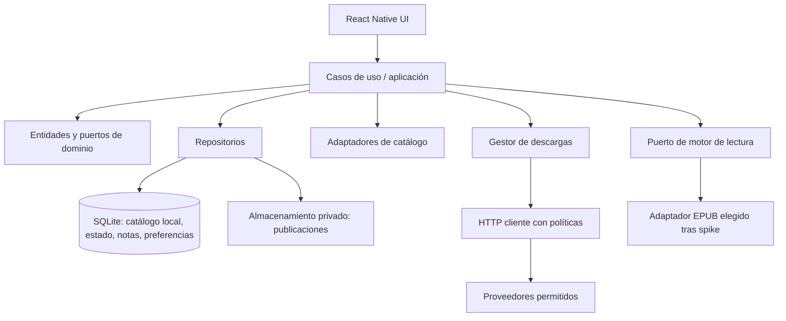

# Arquitectura y decisiones técnicas

## Propuesta

Arquitectura Android local-first, modular por capacidades y con límites explícitos entre presentación, aplicación, dominio e infraestructura. Es un monolito móvil: no necesita servicios backend para biblioteca y lectura en MVP.

Expo queda definido como plataforma del proyecto: usar Expo SDK y su flujo de configuración/build para Android. Priorizar bibliotecas Expo compatibles; ejecutar development builds para módulos nativos. Expo Go es útil para validar UI/prototipos, pero no se considera entorno de aceptación si el lector o una integración nativa no está incluida allí. Para módulos propios, preferir config plugins y código nativo Android acotado, reproducible y documentado.

Para estilos se adopta NativeWind sobre Tailwind CSS. Los tokens de marca viven en la configuración Tailwind; los componentes conservan semántica y estados accesibles. Versiones fijadas deben validarse con `expo install --check` y un build Android. La rama NativeWind 4 estable es la elegida; si una combinación nueva de Expo SDK rompe la integración, resolver compatibilidad antes de ampliar UI.



## Capas

- **Presentación:** pantallas, componentes accesibles, navegación y estado de vista. No ejecuta SQL ni lógica de derechos.
- **Aplicación:** casos de uso como `SearchCatalog`, `DownloadPublication`, `OpenBook`, `SaveReadingLocation`, `CreateAnnotation`, `DeleteLocalCopy`.
- **Dominio:** modelos y reglas puras: publicación, fuente, derechos, descarga, ubicación, anotación y preferencias.
- **Puertos:** interfaces TypeScript para catálogo, repositorio, archivos, reloj, conectividad, logger y lector.
- **Infraestructura:** SQLite/repositorios, filesystem, cliente de red, adaptadores de proveedor y puente al motor de formato.

El patrón recomendado es arquitectura limpia pragmática y puertos/adaptadores. No imponer repositorios para cada tabla o CQRS completo. La UI llama casos de uso; los casos de uso orquestan puertos; los adaptadores implementan detalles.

## Organización sugerida

```text
src/
  app/                 # composición, navegación, proveedores de contexto
  shared/              # tipos comunes, errores, utilidades pequeñas
  features/
    catalog/{ui,application,domain,infrastructure}/
    library/{ui,application,domain,infrastructure}/
    reader/{ui,application,domain,infrastructure}/
    downloads/{ui,application,domain,infrastructure}/
    annotations/{ui,application,domain,infrastructure}/
    settings/{ui,application,domain,infrastructure}/
  platform/            # filesystem, enlaces, accesibilidad, conectividad
  database/            # conexión, migraciones, esquema y consultas
```

Mantener reglas de importación: dominio no depende de React Native, SQLite ni proveedores; aplicación depende de dominio/puertos; infraestructura implementa puertos; UI no accede directamente a infraestructura.

## Persistencia y archivos

- SQLite guarda metadatos y estado pequeño; los EPUB/PDF se guardan como archivos en directorio privado persistente, con nombre interno no confiado y ruta guardada en DB.
- Modelo inicial: `publications`, `creators`, `publication_creators`, `sources`, `downloads`, `reading_positions`, `bookmarks`, `annotations`, `collections`, `collection_items`, `reader_preferences`, `schema_migrations`.
- Identificadores estables (UUID local y `provider_id` externo), timestamps UTC, campos `created_at/updated_at`, integridad referencial y restricciones únicas.
- DB versionada por migraciones; transacciones para cambios relacionados; FTS opcional para metadatos/índice local, medir almacenamiento y reconstruibilidad.
- Configurar foreign keys; evaluar WAL y FTS5 según soporte/build probado; parametrizar entradas; no usar `exec` para valores variables.
- Descarga escribe a archivo temporal, valida longitud/tipo/checksum si disponible, mueve atómicamente a ubicación final y luego confirma estado en DB. La reconciliación al iniciar detecta registros sin archivo y temporales abandonados.
- No almacenar libro en BLOB de SQLite como opción por defecto: complica tamaño, streaming y administración de memoria.

## Dominio de publicación y derechos

Cada título mantiene `source_id`, URL canónica y de descarga, formato, idioma, identificador externo, aviso de derechos, licencia/condiciones, alcance territorial si el proveedor lo informa, fecha de verificación y atribución. La ausencia de un campo no se interpreta como permiso. Proveedores bajo un contrato de adaptador permiten deshabilitar o retirar una fuente sin acoplarla al lector.

Un libro de Project Gutenberg puede tener condiciones y estatus distintos según territorio; su política insta a personas fuera de EE. UU. a revisar el derecho local. Evitar copiar marca o asumir que un enlace descarga permite reempaquetar/distribuir. La app puede ofrecer enlaces de origen y descargas directas según términos autorizados, con revisión legal antes de publicar.

## Lector y formatos

Se eligió `react-native-readium` 5.3 (MIT), puente React Native sobre Readium Kotlin, como motor EPUB. Acepta publicaciones locales y expone locator, eventos de posición y preferencias de tema/tipografía. Al ser nativo requiere development build Expo; el proyecto configura Kotlin 2.3.20 y compile SDK 37 con `expo-build-properties` (JDK 17 en la máquina de build). Readium 3.3 requiere core library desugaring `2.1.5`; el config plugin lo incorpora a Gradle generado y conserva el `ReaderViewModel` que el wrapper instancia por reflexión al minificar release. La apertura de un EPUB propio se verificó en un APK release en emulador API 36. Restan TalkBack, memoria, navegación compleja y más publicaciones en Android físico/emulador. No declarar compatibilidad con DRM.

La posición debe usar locator estable (por ejemplo, identificador de recurso + fragmento/progresión/CFI según formato), no solo número de página visual. Los EPUB reflowables cambian paginación al personalizar.

## Red y descargas

- Adaptador por proveedor, esquema de respuesta normalizado y políticas de retry/backoff/rate limiting conforme a términos. Todo el flujo se inicia y controla desde la UI de la app; no se deriva al navegador ni a un gestor externo.
- Validar HTTPS, host permitido, redirecciones, tamaño máximo, MIME declarado y firma/magic bytes donde corresponda; no confiar únicamente en extensión.
- Manejar descargas cancelables y estados persistidos (`queued`, `downloading`, `paused`, `validating`, `completed`, `failed`, `cancelled`).
- La descarga del MVP ocurre dentro de la app y conserva estados/progreso para recuperarse al volver a abrirla. Descarga sostenida en segundo plano y notificaciones Android se validan en un spike; si se añaden, el control y la biblioteca siguen dentro de la app.
- No enviar metadatos de lectura a proveedor salvo necesidad explícita y transparente.

## Estado y dependencias

Consultar SQLite a través de casos de uso y capas de caché selectivas. Preferir estado de pantalla derivado y pequeño; evitar duplicar como estado global lo persistido. Elegir navegación y librerías después de comprobar mantenimiento, accesibilidad, compatibilidad con el Expo SDK activo, New Architecture y licencias. Gestionar cambios nativos mediante config plugins/prebuild reproducibles y probarlos en development builds Android.

## ADR iniciales

1. **SQLite + filesystem privado:** DB para datos estructurados, archivos para publicaciones; evita BLOB grandes.
2. **Sin cuenta en MVP:** lectura offline y privacidad desde el inicio; sincronización queda fuera de alcance inicial.
3. **Proveedor desacoplado:** los términos y disponibilidad cambian; la interfaz de dominio no depende de un catálogo.
4. **EPUB primero:** el texto reflowable satisface personalización básica; otros formatos requieren lectores y pruebas específicos.
5. **Expo como plataforma:** mantener el flujo Expo para configuración y builds Android; usar development builds y extensiones nativas solo donde el lector o descargas lo requieran.
6. **Motor EPUB:** `react-native-readium` 5.3, wrapper MIT sobre Readium Kotlin; el locator se persiste como JSON en `reading_positions`. `reader_preferences` conserva ajustes visuales por publicación, con valores globales anteriores como compatibilidad durante la migración.
